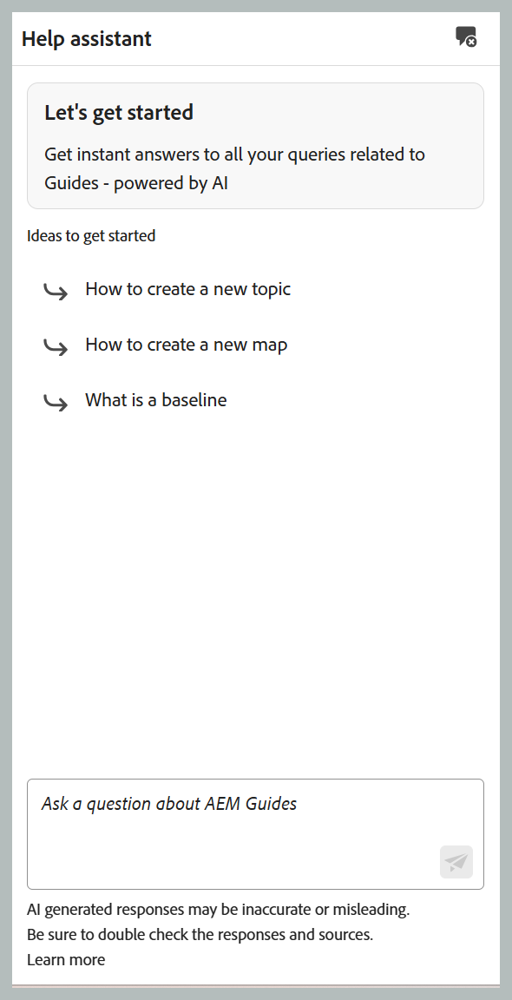
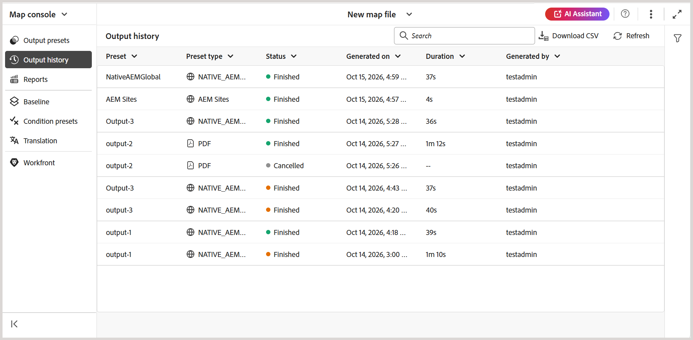

# 2026.11.0 릴리스(2026년 11월)의 새로운 기능

이 문서에서는 Adobe Experience Manager Guides as a Cloud Service 2026.11.0 릴리스와 함께 도입된 새로운 기능 및 향상된 기능을 다룹니다.

이 릴리스에서 수정된 문제 목록을 보려면 [2026.11.0 릴리스에서 수정된 문제](fixed-issues-2026-11-0.md)를 확인하십시오.

[2026.11.0 릴리스의 업그레이드 지침](../release-info/upgrade-instructions-2026-11-0.md)에 대해 알아봅니다.

## 맵 수준 분기 및 병합 소개

Adobe Experience Manager Guides은 맵 수준 분기 및 병합 기능을 도입하여 작성자가 주요 콘텐츠에 영향을 주지 않고 여러 설명서 버전, 기능 업데이트 및 중요 수정 사항을 동시에 작업할 수 있도록 합니다. 작성자는 DITA 맵과 해당 종속 항목의 분리된 분기를 만들어 각 분기에 대한 편집, 잠금 및 미리보기를 유지할 수 있습니다.

이 기능은 설명서 팀이 병렬 워크스트림을 관리하고 효율적으로 공동 작업하며 기본 설명서 버전의 안정성을 유지하는 데 도움이 됩니다. 다음과 같은 작업을 수행할 수 있습니다.

- 기능, 개선 사항 또는 중요 수정 사항을 독립적으로 처리할 수 있도록 DITA 맵의 기본 버전에서 **분기를 만듭니다**.
- 편집기에서 **분기 간 전환**&#x200B;하여 여러 문서 버전을 관리합니다.
- 분기 및 병합을 통해 변경 내용을 구성하려면 **콘텐츠 버전을 관리**&#x200B;하십시오.
- 3방향 병합이 포함된 안내식 비교 워크플로우를 사용하여 **병합 충돌을 해결**&#x200B;합니다.
- 주 버전에 **변경 내용을 병합**&#x200B;합니다.
- 기본 버전을 수정하지 않고 표준 게시를 사용하여 **분기에서 직접 게시**.

[분기 및 병합](../user-guide/branching-overview.md)에 대해 자세히 알아보세요.

{width="650"}

## AI 지원의 AI 기반 콘텐츠 제작 및 가져오기 기술

>[!NOTE]
>
>에이전트 모드에서 AI Assistant를 사용하려면 조직이 Adobe CX Enterprise Coworker에 온보딩되어 필요한 크레딧을 보유하고 있어야 합니다.

이제 **AI Assistant**&#x200B;를 사용하여 자연어 프롬프트를 사용하여 DITA 콘텐츠를 만들고 가져올 수 있습니다. **Adobe CX Enterprise Coworker**&#x200B;에서 제공하는 새로운 **만들기** 및 **가져오기** 기술은 구조화된 콘텐츠를 만들고 작성자가 광범위한 DITA 전문 지식 없이도 DITA 콘텐츠로 작업할 수 있도록 지원합니다.

- **만들기:** 리포지토리 템플릿을 사용하여 자연어 프롬프트, 참조 문서 또는 기존 콘텐츠에서 DITA 주제 및 맵을 생성합니다. 생성된 콘텐츠를 저장하기 전에 검토하고 요구 사항을 충족하도록 새 콘텐츠 또는 기존 콘텐츠를 반복적으로 개선할 수 있습니다.
- **가져오기:** 기존 PDF, DOCX 또는 Markdown 파일을 구조화된 DITA 주제 및 맵으로 변환합니다. 변환된 콘텐츠를 저장소에 저장하기 전에 미리 보고 검토할 수 있습니다.
- **스마트 태그 지정:** 조직의 분류법에 따라 콘텐츠에 대한 관련 태그 권장 사항을 얻을 수 있습니다. 향상된 경험을 통해 폴더 프로필 관리자는 Workspace 설정에서 분류법 네임스페이스를 구성할 수 있으므로 일관된 관리 태그 권장 사항을 유지할 수 있습니다.

**AI Assistant** 패널에는 전체 화면 모드와 향상된 대화 환경을 위한 **활성 대화** 섹션도 도입됩니다.

자세한 내용은 [에이전트 모드에서 AI Assistant 사용](../user-guide/ai-assistant.md#agentic-mode)을 참조하십시오.

{width="650"}

## Experience Manager Guides의 새로운 도움말 지원 패널

생성 AI 기반 **스마트 도움말** 기능은 홈 페이지, 편집기 및 맵 콘솔 인터페이스에서 액세스할 수 있는 전용 **도움말 도우미** 패널을 통해 사용할 수 있습니다. 이 패널에서는 자연어로 질문하고 Experience Manager Guides 설명서에서 관련 정보를 빠르게 찾을 수 있는 대화형 검색 환경을 제공합니다. 이렇게 하면 상황별 지침에 액세스하고 편집기를 종료하지 않고 쿼리를 해결하여 작성 워크플로를 간소화할 수 있습니다.

관리자는 Workspace 설정을 통해 도움말 도우미 패널의 가용성을 관리할 수 있습니다. **AI 도움말 도우미** 섹션에는 사용자의 패널을 활성화하거나 비활성화하는 토글이 포함되어 있습니다.

자세한 내용은 [도움말 길잡이](../user-guide/ai-based-smart-help.md)를 참조하세요.

{width="650"}

## 작성 개선 사항

### 새 편집기의 변경 내용 추적 패널

이제 **변경 내용 추적** 패널을 새 편집기에서 사용할 수 있으므로 항목 내에서 추적된 모든 삽입 및 삭제 내용을 볼 수 있습니다. 여러 사용자가 편집한 내용을 추적하고 패널에서 직접 변경 내용을 적용하거나 거부할 수 있습니다.

삭제된 콘텐츠를 취소선 텍스트로 표시하거나 해당 변경 내용에 연결된 연필 아이콘으로 바꿀 수 있는 **추적된 삭제 표시 인라인** 설정을 사용하여 편집기에서 삭제된 콘텐츠가 표시되는 방식을 제어할 수도 있습니다. [변경 내용 추적](../user-guide/config-editor-settings.md#track-changes)에 대해 자세히 알아보세요.

{width="650"}

### 탐색기 패널에서 파일 및 폴더 정렬

편집기의 **탐색기** 패널에서 **정렬** 단추를 사용하여 파일 및 폴더를 오름차순 또는 내림차순으로 정렬할 수 있습니다. 기본적으로 항목은 **사용자 환경 설정**&#x200B;의 **편집기 파일 표시** 설정에 따라 제목이나 파일 이름별로 오름차순으로 정렬됩니다. 이렇게 하면 편집기에서 콘텐츠를 보다 쉽게 탐색하고 찾을 수 있습니다.

자세한 내용은 페이지 번호를 매긴 파일 및 폴더의 [탐색기](../user-guide/paginated-loading-assets.md#explorer) 섹션을 참조하십시오.

### 편집기에서 DITA가 아닌 파일의 버전 및 레이블 관리

Experience Manager Guides을 사용하면 편집기에서 직접 버전 기록을 보고 이미지, 멀티미디어, ZIP, PDF 및 DOCX 파일과 같은 DITA가 아닌 파일의 버전 레이블을 관리할 수 있습니다. Assets UI로 이동하지 않고도 이러한 파일을 미리 보고, 버전 기록을 검토하고, 버전을 비교하고, 이전 버전으로 되돌릴 수 있습니다. 기존 파일 버전에 대한 버전 레이블을 적용하거나 업데이트하여 버전 식별 및 관리를 간소화할 수도 있습니다.

자세한 내용은 [미디어 및 기타 DITA가 아닌 파일 작업](../user-guide/authoring-file-management.md#work-with-media-and-other-non-dita-files)을 참조하십시오.

{width="650"}

## 향상된 기능 검토

### 개시자 주석을 사용한 검토 공동 작업 개선

검토 개시자는 검토 UI를 사용하여 검토 작업 내의 항목에 인라인 주석 및 주석을 추가할 수 있습니다. 이를 통해 추가 컨텍스트를 제공하고 특정 컨텐츠를 강조하며 피드백이 필요한 영역에 검토자의 주의를 기울일 수 있습니다.

이러한 의견은 다른 검토자의 피드백과 함께 **의견** 패널에 나타나며 검토 토론에 대한 통합된 보기를 제공합니다. 또한 검토자는 개시자가 주석을 추가할 때 AEM 알림을 받게 되므로 검토 프로세스 전반에 걸쳐 공동 작업과 의사 소통을 간소화할 수 있습니다. 자세한 내용은 [검토자를 위한 댓글 추가](../user-guide/review-send-topics-for-review.md#add-comments-for-reviewers)를 참조하십시오.

## 향상된 게시 기능

### 맵 콘솔에서 출력 내역 보기 및 관리

이제 Experience Manager Guides의 맵 콘솔에는 **출력 내역** 탭이 포함되어 있으므로 맵 대시보드로 이동하지 않고도 편집기에서 직접 출력 생성 작업을 보고 관리할 수 있습니다.

탭에는 상태, 사전 설정된 세부 정보, 생성 날짜 및 기간을 포함하여 출력 생성 작업에 대한 통합 보기가 제공됩니다. 작업을 검색 및 필터링하고, 진행 중인 생성을 취소하며, 생성된 출력 및 로그에 액세스하고, 기록에서 완료된 항목을 제거할 수 있습니다. 추가 분석을 위해 출력 기록을 CSV 파일로 내보낼 수도 있습니다. 출력 생성 상태는 맵 대시보드와 일치하는 색상 표시기를 사용합니다.

자세한 내용은 [출력 생성 프로세스 관리](../user-guide/generate-output-manage-process.md#view-and-manage-output-generation-tasks-from-the-editor)를 참조하세요.

{width="650"}

### 향상된 출력 기록 삭제 옵션

출력 기록 **연령별**(지정한 일수보다 오래된 항목 제거) 또는 **횟수별**(지정한 수의 최근 항목만 유지)을 제거할 수 있습니다.

감사 목적으로 기록 항목을 보존하면서 출력 로그만 삭제하거나 로그와 관련 항목을 모두 제거하도록 선택할 수도 있습니다. 이러한 옵션을 사용하면 저장소 저장소를 최적화하는 동시에 출력 기록 삭제를 보다 세밀하게 제어할 수 있습니다.

자세한 내용은 [출력 기록에 대한 자동 제거 기간 구성](../install-conf-guide/conf-output-generation.md#configure-auto-purging-period-for-output-history-id19aai070v8q)을 참조하세요.

### Edge Delivery Services 게시 프로필에 대한 GitLab 지원

Edge Delivery Services 게시는 GitHub와 함께 GitLab에서 호스팅하는 저장소를 지원하므로 DITA 콘텐츠 관리 및 게시에 더 많은 유연성을 제공합니다. GitLab이 호스팅하는 사이트에 게시하려면, Edge Delivery Services 게시 프로필을 만들 때 서버 유형으로 GitLab 을 선택하고 액세스 토큰 필드에 저장소의 프로젝트 액세스 토큰을 제공합니다.

게시 사전 설정에는 하위 폴더에 대한 필드도 포함되어 있으므로 프로필에 지정된 루트 폴더 내의 하위 폴더에 컨텐츠를 게시할 수 있습니다.

자세한 내용은 [Edge Delivery Services 구성](../knowledge-base/publishing/configure-eds.md)을 참조하세요.

### Salesforce 게시 개선 사항

Experience Manager Guides은 향상된 보안, 성능 및 게시 효율성으로 Salesforce 게시를 향상시킵니다. 이러한 개선 사항에는 PKCE(Proof Key for Code Exchange), 새로 고침 토큰 기반 인증, 문서 수준 게시 상태, 자세한 게시 로그, 출력 내역 및 중복 업로드를 줄이는 최적화된 에셋 게시 지원이 포함됩니다.

자세한 내용은 [백엔드 처리를 사용하여 향상된 Salesforce 게시](../user-guide/web-editor-article-publishing.md#enhanced-salesforce-publishing-using-backend-processing)를 참조하십시오.

### 기본 PDF에서 맵 메타데이터의 이미지 지원

기본 PDF 게시는 DITA 맵, 북맵 및 사용자 지정 맵의 메타데이터에 정의된 이미지의 동적 표시를 지원합니다. 생성된 출력에서 제품 커버 이미지와 같은 맵 관련 이미지를 표시하는 동안 여러 맵에서 단일 PDF 템플릿을 사용할 수 있습니다.

페이지 레이아웃에 이미지 자리 표시자를 추가하면 게시 중에 맵 메타데이터에서 참조되는 이미지로 이미지 자리 표시자를 자동으로 채울 수 있습니다. 따라서 이미지에 따라 별도의 템플릿을 유지 관리할 필요가 없고 템플릿 관리를 간소화할 수 있습니다.

자세한 내용은 [맵 메타데이터에서 이미지 추가](../native-pdf/design-page-layout.md#add-an-image-from-map-metadata-add-image-map-metadata)를 참조하세요.

### 이전 편집기에서 컨텐츠 상태 점검을 사용하여 컨텐츠 품질 유효성 검사

콘텐츠 상태 검사는 이전 편집기(새 편집기에서 이미 지원됨)에서 사용할 수 있으므로 게시하기 전에 DITA 맵에서 콘텐츠 품질을 확인하는 데 도움이 됩니다. 관리자는 끊어진 링크, 중복 ID 및 Schematron 유효성 검사를 결합하여 재사용 가능한 상태 검사 사전 설정을 만들 수 있습니다.

작성자는 DITA 맵 또는 이전 편집기의 선택한 베이스라인에서 상태 검사를 실행하여 연관된 주제 및 맵에서 문제에 대한 통합 보고서를 생성할 수 있습니다. 자세한 내용은 [맵에서 상태 확인 실행](../user-guide/map-editor-other-features.md#run-health-check-on-a-map)을 참조하세요.

## 이전 컨텐츠 마이그레이션에 대한 API 업데이트

이 API를 사용하면 단일 API를 통해 콘텐츠 및 해당 메타데이터를 만들거나 업데이트할 수 있습니다. 요청에 주제 콘텐츠, 메타데이터 및 GUID를 지정할 수 있습니다. API는 `/bin/guides/v1/asset/upsert/`의 Swagger API 설명서에서 사용할 수 있습니다.