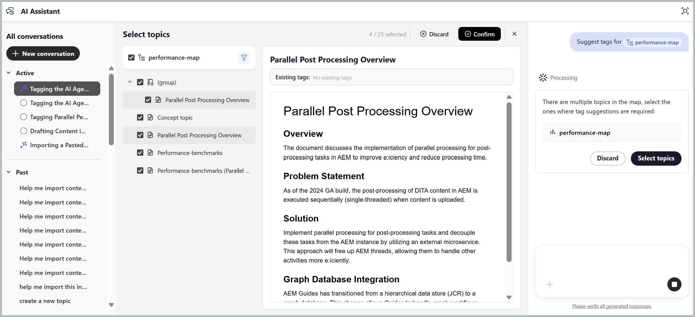

# AI Assistant를 사용한 스마트 태그 지정

Adobe CX Enterprise Coworker을 통해 AI Assistant의 에이전트 모드에서 사용할 수 있는 스마트 태그 지정 기술을 사용하면 콘텐츠에 태그를 보다 빠르고, 쉽고, 일관되게 지정할 수 있습니다. 콘텐츠를 분석하고 조직의 분류법에 따라 관련 태그를 권장하므로 콘텐츠를 수동으로 검토하고 적용 가능한 태그를 식별할 필요가 없습니다. 관리자는 작업 영역에 대해 관련 네임스페이스를 선택하여 [Workspace 설정](../install-conf-guide/workspace-settings.md#general)을 통해 태그 권장 사항을 생성하는 데 사용되는 분류를 구성할 수 있습니다.

선택 내용을 확인하기 전에 제안된 태그를 검토하고 적용 또는 거부하도록 선택하여 통제력을 유지합니다. 이를 통해 수작업이 줄어들고 태그 지정의 정확도가 향상되며 설명서 전체에서 일관된 메타데이터를 유지할 수 있습니다.

## 스마트 태그 지정 스킬을 사용하여 단일 또는 여러 주제에 태그 적용

스마트 태그 지정 스킬로 단일 또는 여러 주제에 태그를 적용하는 경우 AI Assistant를 사용하려면 다음 단계를 수행하십시오.

1. Experience Manager Guides에 로그인.
1. 홈 페이지의 탐색 모음에서 **AI 길잡이**&#x200B;를 선택합니다. 관리자가 에이전트 모드에서 [AI 도우미](../install-conf-guide/workspace-settings.md)를 사용하도록 설정했는지 확인하십시오.
1. 다음 방법 중 하나를 사용하여 태그 권장 사항을 생성할 주제를 추가합니다.

   - **제안된 프롬프트 사용**: 응답 영역에서 첫 번째 채팅을 수행하려면 **파일에 태그 제안** 프롬프트를 선택하십시오. 프롬프트가 프롬프트 공간에 자동으로 추가됩니다. `[file]`을(를) 선택한 다음 **파일 선택** 대화 상자의 리포지토리 또는 컬렉션에서 주제를 선택합니다. **파일 선택** 대화 상자에서 항목을 하나 선택할 수 있습니다.

     {width="650"}

   - **바로 가기 사용**: 프롬프트 필드에 `/`을(를) 입력한 다음 **저장소 참조 추가**&#x200B;를 선택하여 리포지토리에서 항목을 선택하거나 **장치에서 파일 추가**&#x200B;를 선택하여 컴퓨터에서 항목을 업로드합니다. *파일에 대한 태그 제안*&#x200B;과 같은 프롬프트를 입력합니다.

   - **끌어다 놓기**: 단일 주제 또는 여러 주제를 프롬프트 공간으로 끌어다 놓고 *파일에 대한 태그 제안*&#x200B;과 같은 프롬프트를 입력합니다.

     {width="650"}

   - **주제 경로 지정**: `@`을(를) 입력한 다음 동일하거나 다른 맵의 여러 주제에 대해 쉼표로 구분된 경로를 입력하고 *파일에 대한 태그 제안*&#x200B;과 같은 프롬프트를 입력하십시오.

     {width="650"}

1. **보내기**&#x200B;를 선택합니다.

1. AI 비서가 주제의 콘텐츠를 분석하고 태그 권장 사항을 생성합니다.

   분석 및 생각하는 동안 Agentic AI Assistant 패널의 {width="650"}

1. 다음과 같이 제안된 태그를 검토합니다.

   >[!NOTE]
   >
   > 이미 태그가 들어 있는 항목의 경우 AI Assistant는 기존 태그를 표시합니다. 이러한 태그는 읽기 전용이므로 수정하거나 제거할 수 없습니다.

   - 단일 주제의 경우 권장 사항을 적용하려면 **수락**&#x200B;하거나 필요하지 않은 경우 **거부**&#x200B;할 수 있습니다.

     {width="650"}

   - 여러 주제의 경우:
     1. AI가 생성한 태그 권장 사항을 검토하려면 **미리 보기**&#x200B;를 선택하십시오.

        {width="650"}

     1. 각 주제에 대해 제안된 태그를 검토한 후 다음 작업 중 하나를 선택합니다.
        - **모두 수락**&#x200B;하여 모든 주제에 대해 제안된 태그를 모두 적용합니다.
        - **모두 거부**&#x200B;하여 모든 항목에 대해 제안된 태그를 모두 버립니다.
        - 특정 주제에 대해 제안된 태그를 모두 제거하려면 **모든 제안을 지웁니다**.
        - 개별 태그 제안을 제거하려면 태그 옆에 있는 **X** 아이콘을 선택하십시오.

          {width="650"}

1. 제안된 태그를 수락하면 스마트 태그 지정 스킬은 콘텐츠에 이미 적용된 태그에 AI가 생성한 태그를 추가합니다.

검토를 완료하면 AI 비서가 주제에 적용된 태그 요약과 거부된 태그 권장 사항을 표시합니다.

{width="650"}

## 스마트 태그 지정 스킬을 사용하여 맵의 여러 주제에 태그 적용

스마트 태그 지정 스킬로 맵의 여러 주제에 태그를 적용하는 AI Assistant를 사용하려면 다음 단계를 수행하십시오.

1. Experience Manager Guides에 로그인.
1. 홈 페이지의 탐색 모음에서 **AI 길잡이**&#x200B;를 선택합니다. 관리자가 에이전트 모드의 AI Assistant를 활성화했는지 확인합니다.
1. 주제에 대해 설명된 대로 다음 방법 중 하나를 사용하여 태그 권장 사항을 생성할 맵을 추가합니다.

   - **제안된 프롬프트 사용**: 응답 영역에서 첫 번째 채팅을 수행하려면 **파일에 태그 제안** 프롬프트를 선택하십시오. 프롬프트가 프롬프트 공간에 자동으로 추가됩니다. `[file]`을(를) 선택한 다음 **파일 선택** 대화 상자의 저장소 또는 컬렉션에서 맵을 선택합니다.

   - **끌어다 놓기**: 맵을 프롬프트 공간으로 끌어다 놓고 *파일에 대한 태그 제안*&#x200B;과 같은 프롬프트를 입력합니다.

   - **바로 가기 사용**: 프롬프트 필드에 `/`을(를) 입력한 다음 **저장소 참조 추가**&#x200B;를 선택하여 저장소에서 맵을 선택하거나 **장치에서 파일 추가**&#x200B;를 선택하여 컴퓨터에서 맵을 업로드합니다. *파일에 대한 태그 제안*&#x200B;과 같은 프롬프트를 입력합니다.

     {width="650"}

1. **보내기**&#x200B;를 선택합니다.
선택한 맵에 여러 주제가 포함되어 있음을 나타내는 메시지가 표시됩니다. 태그를 추천할 주제를 선택하려면 **주제 선택**&#x200B;을 선택하십시오.

   항목을 선택하는 동안 {width="650"}

1. **주제 선택** 대화 상자에서 태그 추천을 원하는 주제를 선택합니다.\
   **주제 선택** 대화 상자는 다음을 제공합니다.

   - **주제 목록:** 선택한 맵의 모든 주제를 표시합니다. 태그 권장 사항을 생성할 주제를 선택합니다.
   - **미리 보기 창:** 선택한 항목의 미리 보기를 기존 태그와 함께 표시합니다.
   - **필터:** 항목을 필터링하여 **태그가 추가된 항목만 표시하거나** 또는 **태그가 추가되지 않은 항목만 표시합니다**.

     {width="650"}

1. **확인**&#x200B;을 선택합니다. AI Assistant는 선택한 주제를 분석하고 각 주제에 대해 생성된 태그 권장 사항 수를 표시합니다.
1. AI가 생성한 태그 권장 사항을 검토하려면 **미리 보기**&#x200B;를 선택하십시오.
1. 각 주제에 대해 제안된 태그를 검토한 후 다음 작업 중 하나를 선택합니다.
   - **수락**&#x200B;하여 모든 주제에 대해 제안된 태그를 모두 적용합니다.
   - **거부**&#x200B;하여 모든 항목에 대해 제안된 태그를 모두 버립니다.
   - 특정 주제에 대해 제안된 태그를 모두 제거하려면 **모든 제안을 지웁니다**.
   - 개별 태그 제안을 제거하려면 태그 옆에 있는 **X** 아이콘을 선택하십시오.

     >[!NOTE]
     >
     > 이미 태그가 들어 있는 항목의 경우 AI Assistant는 기존 태그를 표시합니다. 이러한 태그는 읽기 전용이므로 수정하거나 제거할 수 없습니다.

   {width="650"}

1. 제안된 태그를 수락하면 스마트 태그 지정 스킬은 콘텐츠에 이미 적용된 태그에 AI가 생성한 태그를 추가합니다.

검토를 완료하면 AI Assistant에 각 주제에 적용되는 태그 요약 및 거부된 태그 권장 사항이 표시됩니다.

