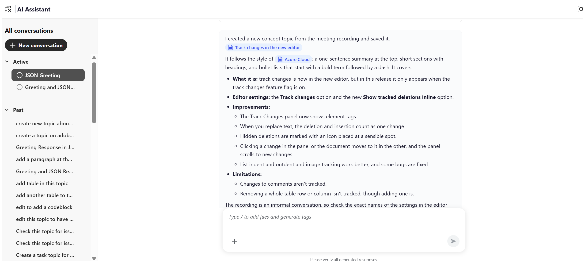

# 콘텐츠의 첫 번째 초안 만들기

AI Assistant의 에이전트 모드에서 **만들기** 스킬을 사용하면 메모, 사양, 화이트보드 이미지, 스크린샷 또는 기타 사용 가능한 참조 자료에서 구조화된 컨텐츠의 첫 번째 초안을 생성할 수 있습니다. 이 스킬은 저장소에서 사용할 수 있는 콘텐츠 및 주제 템플릿을 기반으로 개념, 작업, 참조 또는 문제 해결과 같은 적절한 DITA 주제 유형을 자동으로 식별하여 콘텐츠를 구성하고 작성하는 데 필요한 수작업을 줄입니다.

파일을 첨부하고 기존 파일을 톤 및 스타일에 대한 참조로 선택한 다음 생성된 내용을 저장할 폴더를 지정할 수 있습니다. 원하는 컨텐츠의 첫 번째 초안을 만들려면 다음 단계를 수행하십시오.

1. Experience Manager Guides에 로그인.
1. 홈 페이지의 탐색 모음에서 **AI 길잡이**&#x200B;를 선택합니다. 관리자가 에이전트 모드에서 [AI 도우미](../install-conf-guide/workspace-settings.md)를 사용하도록 설정했는지 확인하십시오.

1. AI 도우미 패널에서 **만들기**&#x200B;를 선택합니다.

   시작 프롬프트가 프롬프트 상자에 나타납니다. *첨부 파일을 참조하고 [파일]*&#x200B;과(와) 유사한 색조의 콘텐츠를 가진 초안 콘텐츠를 만듭니다.

1. 다음 방법 중 하나를 사용하여 메모, 사양 또는 기타 참조 파일을 프롬프트에 첨부합니다.

   - **바로 가기 사용**: 프롬프트 필드에 `/`을(를) 입력한 다음 **저장소 참조 추가**&#x200B;를 선택하여 리포지토리에서 파일을 선택합니다(또는 **장치에서 파일 추가**&#x200B;를 선택하여 컴퓨터에서 파일 업로드).

   - **파일 첨부 또는 컨텍스트 아이콘 추가 사용(+)**: 로컬 시스템에서 파일을 추가합니다.

   - **끌어다 놓기**: 시스템에서 초안할 파일을 프롬프트 공간으로 바로 끌어다 놓습니다.

1. *(선택 사항)* 시작 프롬프트에서 `[file]`을(를) 선택합니다. 초안을 일치시킬 색조가 있는 기존 항목을 선택합니다. 저장소 또는 컬렉션에서 항목을 선택할 수 있습니다. 항목 이름이 프롬프트에서 `[file]`을(를) 대체합니다.

   {width="650"}

1. **보내기**&#x200B;를 선택합니다.

   AI Assistant는 콘텐츠를 분석하고 완료된 각 단계를 나열합니다.

1. AI Assistant의 후속 질문에 답변하여 콘텐츠 생성에 필요한 세부 사항을 제공합니다.

   {width="650"}

1. 생성된 항목을 검토하려면 **미리 보기**&#x200B;를 선택하십시오.

   각 초안을 출처 자료와 요청한 항목 유형에 대해 확인합니다.

   

1. 다음 중 하나를 선택합니다.

   - **수락**&#x200B;하여 항목을 확인한 폴더에 저장합니다.
   - 저장하지 않고 변경 내용을 취소하려면 **거부**&#x200B;하십시오. 초안 콘텐츠를 거부하는 이유를 입력하고 원하는 변경 사항을 지정하는 프롬프트를 입력할 수 있습니다. AI Assistant는 사용자 피드백을 사용하여 초안 콘텐츠를 수정합니다.

     이제 저장소에서 주제를 사용할 수 있습니다.

     

AI Assistant가 항목을 만든 후 편집기에서 열고 후속 프롬프트를 사용하여 콘텐츠를 세분화할 수 있습니다. 이를 통해 새로운 대화를 시작하지 않고도 주제를 반복적으로 개선할 수 있다. 제안된 각 변경 내용은 미리 보기에 표시되며 **변경 내용 추적**&#x200B;을 사용할 수 있습니다. 이렇게 하면 수정 내용을 적용한 후 검토할 수 있습니다.

예를 들어 생성된 주제의 제목을 세분화하려면 다음을 수행합니다.

1. 편집기 의 AI 지원 대화 상자에서 새로 만든 주제를 엽니다.

   

1. AI 지원 패널에서 `Improve the title of this topic to make it generic.`과(와) 같은 후속 프롬프트를 입력합니다.

   

1. **보내기**&#x200B;를 선택합니다.

   AI 비서가 새로운 타이틀을 분석하고 제안합니다.

1. 제안된 변경 내용을 검토하려면 **미리 보기**&#x200B;를 선택하십시오.

   미리보기에는 수정된 제목이 추적된 변경 사항과 함께 표시되며 수정된 내용이 강조 표시됩니다.

   

1. **승인**&#x200B;을 선택하여 변경 내용을 주제에 적용합니다.

   

동일한 대화에서 추가 프롬프트를 제공하여 단락, 단계 또는 표와 같은 주제의 다른 요소를 계속 구체화할 수 있습니다.

