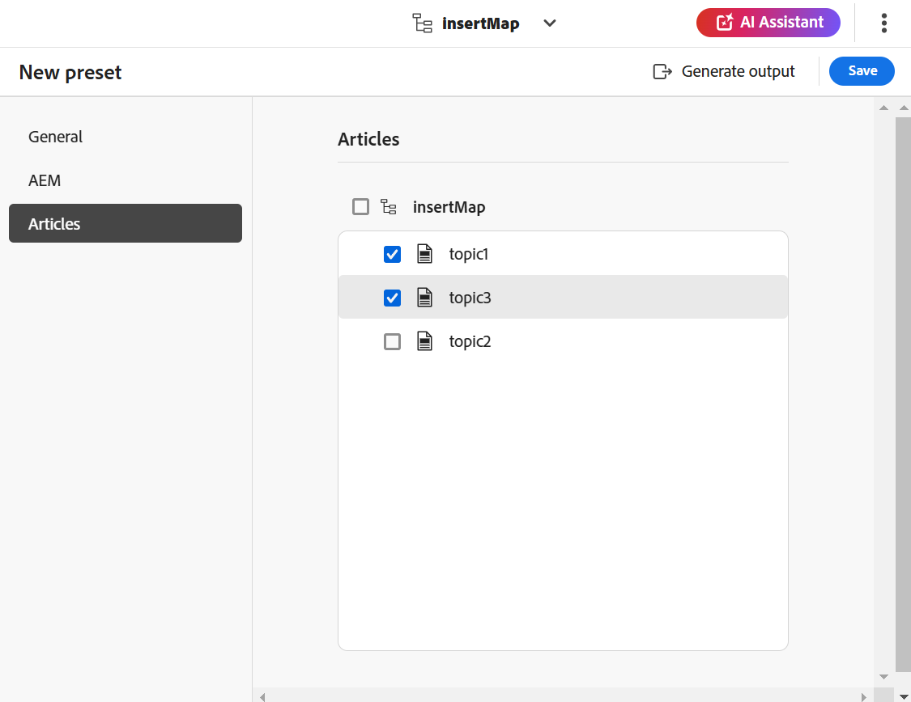

# 기술 자료 출력 생성 {#id218CL05J0M1}

Adobe Experience Manager Guides에는 사용자가 하나 이상의 기술 자료 문서를 동시에 게시할 수 있는 문서 기반 게시 기능이 포함되어 있습니다.

이 엔진에는 Adobe Experience Manager 핵심 구성 요소 위에 구축된 OOTB 콘텐츠 템플릿도 함께 제공됩니다. 이 템플릿을 사용하면 기술 콘텐츠에 대한 지식 기반 저장소를 생성할 수 있습니다. 이 템플릿은 고객의 요구 사항에 맞게 사용자 지정할 수 있습니다.이 엔진을 사용하면 추가 방식으로 DITA 맵을 작성하고 준비가 되면 항목을 게시할 수 있습니다.

DITA 맵의 일부 주제에 대해서만 콘텐츠를 업데이트한 경우 전체 맵을 항상 게시하지 않아도 됩니다. 업데이트된 항목만 선택하여 게시할 수 있습니다.

문서 기반 게시의 경우 기술 자료 DITA 맵에 대한 출력 사전 설정을 만들어야 합니다. 맵에는 게시하려는 주제가 포함되어야 합니다. 조건을 적용하고 출력 사전 설정에 대한 AEM Sites 세부 정보를 지정할 수도 있습니다. 그런 다음 **출력 생성** 기능을 사용하여 출력을 생성할 수 있습니다.

문서 기반 출력을 생성하려면 다음 단계를 수행하십시오.

1. 문서 기반 출력을 위해 [기술 자료 사전 설정을 만듭니다](./generate-output-knowledge-base.md).
1. **문서** 탭으로 이동하여 출력을 생성할 주제를 선택합니다.

   

   >[!NOTE]
   >
   > Salesforce에 게시할 때 게시할 주제를 선택하지 않은 경우 **문서** 탭 옆에 경고 아이콘이 표시됩니다. 하나 이상의 주제를 선택하면 경고 아이콘이 사라집니다.
1. 맨 위에 있는 **출력 생성**&#x200B;을 선택하여 출력을 생성합니다.
1. **게시할 파일 확인** 프롬프트에서 게시할 파일을 선택하고 **게시**&#x200B;를 선택하여 확인합니다.

   

   출력 생성 프로세스의 상태를 볼 수 있습니다. **주제** 열에는 출력이 생성되는 주제가 나열되며 **상태** 열에는 각 주제의 게시 상태가 표시됩니다.

   

   출력을 보려면 **생성된 출력** 대화 상자를 닫고 사전 설정 페이지에서 **출력 보기**&#x200B;를 선택하십시오.

   >[!NOTE]
   >
   > [옵션] 메뉴에서 기존 출력 사전 설정의 이름을 바꾸거나, 복제하거나, 삭제할 수도 있습니다.

## 백엔드 처리를 사용하여 향상된 Salesforce 게시

Experience Manager Guides as Cloud Service의 2026.11.0 릴리스부터 향상된 Salesforce 게시 환경을 사용할 수 있습니다. 백엔드 처리를 사용하여 더 큰 게시 작업을 지원하고, 보안을 개선하고, 기존 게시 프로세스의 문제를 해결합니다.

>[!NOTE]
>
> 향상된 Salesforce 게시 환경은 기본적으로 비활성화되어 있습니다. 활성화하려면 Adobe 고객 성공 팀에 문의하십시오.

향상된 경험을 사용하여 Salesforce에 문서를 게시하면 다음과 같은 추가 기능을 사용할 수 있습니다.

- **선택하지 않은 주제에 대한 경고**: 게시하도록 선택한 주제가 없을 때 Salesforce 기술 자료 출력 사전 설정의 **문서** 탭에 경고 표시기가 나타납니다. 하나 이상의 주제를 선택하면 경고가 사라집니다.

  
- **문서 수준 게시 상태**: 출력 생성 후 각 문서의 게시 상태(예: 성공 또는 실패)와 함께 항목 또는 파일 이름이 **Saleforce 게시 결과** 대화 상자에 표시됩니다.

  

- **게시 로그**: Salesforce 기술 자료 출력 사전 설정에서 **로그 보기** 옵션을 사용하여 게시 로그를 검토하고 오류 또는 경고를 해결합니다.

  

  또한 로그에는 게시 결과에 대한 요약이 제공됩니다.

  
- **출력 기록**: **맵 콘솔** 또는 **Assets UI**&#x200B;에서 게시 작업의 출력 기록을 봅니다.

  게시 작업 관리에 대한 자세한 내용은 [출력 생성 프로세스 관리](./generate-output-manage-process.md)를 참조하십시오.

  
- **자산 게시를 최적화했습니다.** Salesforce에 항목을 게시할 때 Experience Manager Guides은 멀티미디어 및 기타 비 DITA 파일과 같은 참조된 자산이 마지막 게시 이후 수정되었는지 확인합니다. 수정된 자산만 다시 게시되고 변경되지 않은 자산은 건너뜁니다. 이를 통해 중복 에셋 업데이트가 줄어들고 게시 효율성이 향상됩니다.

### PKCE 및 새로 고침 토큰 기반 인증

향상된 Salesforce 게시 경험은 새로 고침 토큰 기반 인증도 지원하므로 액세스 토큰이 만료될 때 Experience Manager Guides에서 Salesforce에 반복적으로 로그인할 필요가 없습니다.

>[!NOTE]
>
> 새로 고침 토큰 지원은 기본적으로 비활성화되어 있습니다. 활성화하려면 Adobe 고객 성공 팀에 문의하십시오.

이 기능을 사용하려면 **언제든지 요청 수행(refresh_token, offline_access)**&#x200B;이 선택한 OAuth 범위에 포함되어 있는지, **지원되는 인증 흐름에 대한 PKCE(Proof Key for Code Exchange) 확장 필요**&#x200B;가 Salesforce 연결 앱에서 활성화되어 있는지 확인하십시오.

Experience Manager Guides에서 새로 고침 토큰 지원을 활성화하면 PKCE가 자동으로 지원됩니다. 하지만 인증이 제대로 작동하려면 Salesforce에서도 해당 설정을 활성화해야 합니다.

**상위 항목:**[&#x200B;편집기 작업](web-editor.md)
